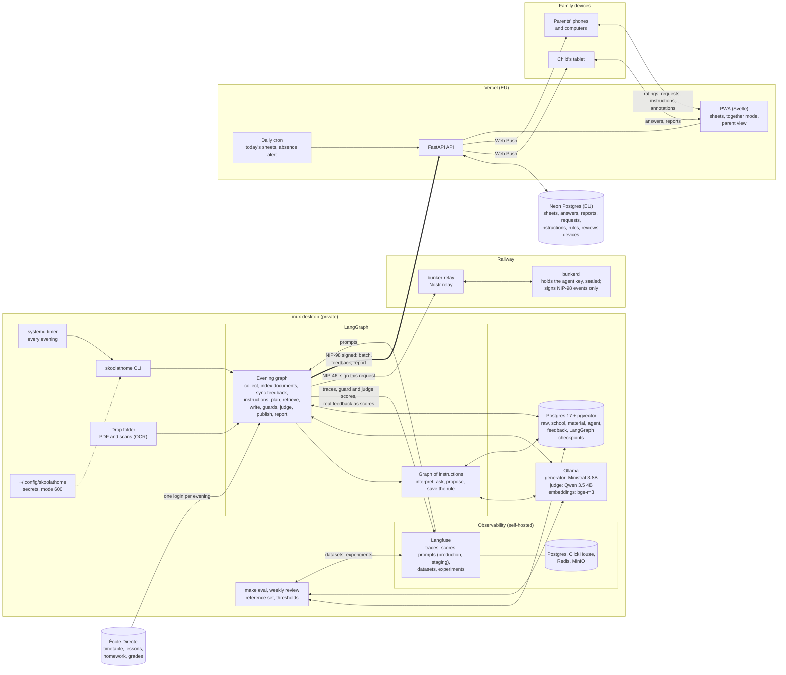

# skoolathome

Revision sheets for a French *collège* student, built every evening from what the teachers wrote in École Directe, by a model that runs on a Linux desktop at home.

- **Grounded in the course.** Every question quotes the lesson or the textbook page it comes from. Deterministic guards check every quote, answer and computation. A judge model from another family then reads each sheet. When the agent cannot make a sheet that passes, it abstains and says why.
- **Private by design.** École Directe credentials, lesson texts and model calls stay on the Linux desktop. Only the finished sheets go online, with no surname.
- **Done on a tablet**, alone (instant correction, hints) or together with a parent (✓ ~ ✗ ratings, parent guide). The parent can ask for a sheet, give instructions in plain French and annotate a few sheets each week.
- **Measured.** Every sheet has a Langfuse trace, and real answers and reports come back to that trace. A reference set (`make eval`) blocks any prompt or model change that makes the sheets less correct.

The family-facing app and the command messages are in French.

## Architecture



| Component | Where | Role |
|---|---|---|
| Collector | Linux desktop | Reads École Directe once per evening (one login, never retried in a loop) into `raw` (responses as received) and `school` (a common format). |
| Evening graph | Linux desktop, LangGraph | Plans the evening's sheets from rules (no model involved), gathers the lesson texts and the closest document pages, has the generator write each sheet in an imposed JSON shape, runs the guards, then the judge. Up to three generations per sheet, else an abstention with its reason. Checkpoints in Postgres: a run stopped half-way resumes. |
| Graph of instructions | Linux desktop, LangGraph | Turns « le prof d'histoire interroge à chaque cours » into a rule. It asks instead of guessing, and saves nothing until the parent approves. It pauses between steps (`interrupt`), resumed when the parent's reply comes back. |
| Ollama | Linux desktop | All model calls go through its OpenAI-compatible API: changing the engine is one line in `models.toml`. |
| App database | Linux desktop, Docker | Postgres with pgvector, separate from Langfuse's, so Langfuse can be wiped without touching the student's data. |
| Langfuse | Linux desktop, Docker | One trace per sheet, with the subject, the rule, the format, the model and the prompt versions. It also holds the guard and judge scores, the real feedback, the managed prompts with their `production` and `staging` labels, the reference datasets and the `make eval` experiments. Stopped outside the evening run, it frees 3 to 4 GB of RAM. |
| Remote signer | Railway | [nostr-remote-signer](https://github.com/bonpiedlaroute/nostr-remote-signer): the Linux desktop never holds the key that the API trusts. Every call to the API is a NIP-98 event signed through NIP-46, and the signer only signs that event kind. |
| API and PWA | Vercel, Neon | FastAPI functions and the Svelte app. Devices pair with a one-time code and keep an HttpOnly session cookie. The Linux desktop authenticates with NIP-98. Web Push carries the evening report, the weekly review and the finished sheets. |

Each evening the Linux desktop makes three signed calls: it fetches the feedback, publishes one batch, and sends the report. The batch carries the sheets, the answers to the parent's requests and instructions, the list of rules and the weekly review.

## Installation

This is a single-family setup: one Linux desktop, one student, a few devices. Budget an afternoon.

### What you need

- **A Linux desktop that stays on in the evening**, with 16 GB of RAM at least (32 GB is comfortable: the generator takes about 6 GB, Langfuse 3 to 4 GB). Developed on Ubuntu 22.04 with an Intel Core Ultra 5 125U and no discrete GPU: a sheet takes 7 to 10 minutes.
- **Docker** with Compose, [uv](https://docs.astral.sh/uv/), Node.js 20 or later, git, openssl.
- **Accounts**: an École Directe parent account, GitHub, [Vercel](https://vercel.com) (Hobby plan, with its Neon integration), [Railway](https://railway.com).
- Optional, for scanned documents: `sudo apt install ocrmypdf tesseract-ocr-fra`.

### 1. Code and local database

```bash
git clone https://github.com/bonpiedlaroute/skoolathome.git && cd skoolathome
uv sync
(cd web && npm ci)

mkdir -p ~/.config/skoolathome && chmod 700 ~/.config/skoolathome
(umask 077 && openssl rand -hex 24 > ~/.config/skoolathome/app-db-password)
docker compose -f deploy/compose.yaml up -d      # Postgres 17 + pgvector on 127.0.0.1:5433
uv run skoolathome db migrate
make test                                         # Python and PWA tests (they create throw-away databases)
```

### 2. École Directe

```bash
uv run skoolathome-ed-probe --interactive   # asks for the login, answers the security question once
uv run skoolathome collect
uv run skoolathome summary                  # upcoming tests and lessons, without any model
```

The credentials are stored in `~/.config/skoolathome/ecoledirecte.json` (mode 600). The model never sees them.

### 3. Local models

```bash
curl -fsSL https://ollama.com/install.sh | sh
sudo mkdir -p /etc/systemd/system/ollama.service.d
sudo tee /etc/systemd/system/ollama.service.d/override.conf >/dev/null <<'EOF'
[Service]
Environment="OLLAMA_HOST=127.0.0.1:11434"
Environment="OLLAMA_CONTEXT_LENGTH=8192"
Environment="OLLAMA_NUM_PARALLEL=1"
Environment="OLLAMA_MAX_LOADED_MODELS=1"
Environment="OLLAMA_KEEP_ALIVE=5m"
EOF
sudo systemctl daemon-reload && sudo systemctl restart ollama
ollama pull ministral-3:8b-instruct-2512-q4_K_M
ollama pull qwen3.5:4b-q4_K_M
ollama pull bge-m3
uv run skoolathome llm bench      # reading and writing speed, memory, per model
```

On an Intel iGPU, the developer's Linux desktop also sets `OLLAMA_IGPU_ENABLE=1` (with the `ollama` user in the `render` and `video` groups) and `LLAMA_ARG_THREADS` to its number of performance threads. The models are declared in `src/skoolathome/agent/models.toml`.

### 4. Langfuse

```bash
deploy/langfuse/langfuse.sh init     # secrets in ~/.config/skoolathome/langfuse.env and langfuse.json
deploy/langfuse/langfuse.sh start    # http://localhost:3000, a few minutes the first time
uv run skoolathome prompt push       # the prompts of src/skoolathome/agent/prompts/, labelled production
uv run skoolathome llm try           # a first traced call: it prints the trace link
```

The login is `parent@skoolathome.local`, and the password is `LANGFUSE_PASSWORD` in `langfuse.env`. Everything works without Langfuse: tracing is then off, and the local copies of the prompts are used.

### 5. Remote signer on Railway

```bash
docker build -t skoolathome-bunker deploy/railway
printf 'passphrase: '; read -rs BUNKER_PASSPHRASE; echo; export BUNKER_PASSPHRASE
mkdir -p ~/.config/skoolathome/bunker-keys && cd ~/.config/skoolathome/bunker-keys
for k in signer identity; do
  openssl rand -hex 32 | docker run --rm -i -e BUNKER_PASSPHRASE skoolathome-bunker \
    sh -c "seal /tmp/k.json >&2; cat /tmp/k.json" > $k.sealed.json
done
chmod 600 *.sealed.json && cd -
```

The first public key printed is the transport key; the second is the agent's identity. Then create two Railway services from your GitHub repository, both with root directory `deploy/railway`:

| Service | Variables | Network |
|---|---|---|
| `bunker-relay` | `BUNKER_ROLE=relay`, `BUNKER_RELAY_SIGNERS=<transport public key>`, `PORT=7777` | public domain, target port 7777 |
| `bunkerd` | `BUNKER_ROLE=vault`, `BUNKER_PASSPHRASE`, `BUNKER_RELAY=wss://<relay domain>`, `BUNKER_SIGNER_SEALED_B64=$(base64 -w0 signer.sealed.json)`, `BUNKER_IDENTITY_SEALED_B64=$(base64 -w0 identity.sealed.json)` | no public domain, a volume on `/data` |

Read the `bunker URI` and `identity` lines in the logs of `bunkerd`, then:

```bash
uv run skoolathome signer new-token --uri 'bunker://…' --identity npub1…
# add the BUNKER_AGENTS_JSON it prints to the variables of bunkerd
uv run skoolathome signer test              # « Signé à distance (type 27235) »
uv run skoolathome signer test --kind 1     # « Refusé » : the signer only signs NIP-98 events
```

The passphrase is the root of trust: anyone with access to the Railway project can unseal the keys.

### 6. API and PWA on Vercel

1. Push the repository to GitHub, and import it in Vercel. `vercel.json` builds the PWA, serves the API from `main.py` in region `cdg1`, and schedules the daily cron.
2. In the project's Storage tab, add a **Neon** database in an EU region. It sets `DATABASE_URL`.
3. In Settings, Environment Variables (Production):

| Variable | Value |
|---|---|
| `SKOOLATHOME_AGENT_PUBKEY` | the agent's identity, `npub1…` (step 5) |
| `SKOOLATHOME_VAPID_PUBLIC_KEY`, `SKOOLATHOME_VAPID_PRIVATE_KEY` | from `uv run skoolathome api vapid-keys` |
| `CRON_SECRET` | `openssl rand -hex 32` |
| `SKOOLATHOME_BOOTSTRAP_CODE` | optional: pairs the first parent device without the Linux desktop (`uv run skoolathome api bootstrap-code`) |
| `SKOOLATHOME_ABSENCE_HOURS` | optional, default 36: alert when nothing was published for that long on a school day |

4. Deploy, then migrate Neon from the Linux desktop and save the API address:

```bash
DATABASE_URL='postgresql://…neon.tech/…?sslmode=require' uv run skoolathome api migrate
uv run skoolathome api set-url https://<your-project>.vercel.app
```

Redeploy after each change of variables: Vercel reads them at deployment.

### 7. Pair the devices

```bash
uv run skoolathome pair --label "Parent phone"    # a QR code, a link and an 8-character code
```

Open the link on the phone (or scan the QR code, or type the code at the site's address). Then, from the parent view on that phone, **Appareils** creates the codes for the child's tablet (role *Enfant*) and the other devices. On the tablet, add the site to the home screen, and allow notifications.

### 8. The first evenings

```bash
uv run skoolathome plan                       # what tonight would make, and what it skips, with the reason
uv run skoolathome evening --no-publish       # the whole run, kept on the Linux desktop
uv run skoolathome sheets list && uv run skoolathome sheets show <id>
uv run skoolathome evening                    # the real one: collect, sheets, publish, report
```

Then the timer. **Edit `WorkingDirectory` in `deploy/systemd/skoolathome-evening.service`** to your clone's path, and:

```bash
cp deploy/systemd/skoolathome-evening.* ~/.config/systemd/user/
systemctl --user daemon-reload
systemctl --user enable --now skoolathome-evening.timer
loginctl enable-linger "$USER"                # so the user timer runs without an open session
```

## Day to day

| Command | What it does |
|---|---|
| `skoolathome evening [--no-collect] [--no-publish] [--restart]` | the evening run; resumes an interrupted run of the same day |
| `skoolathome ask maths les fractions égales --revision --now` | a sheet on demand, made and published now (also from the PWA) |
| `skoolathome instructions add "…"` / `instructions sync` | an instruction in plain French; read the ones written in the PWA now |
| `skoolathome rules list` / `rules set before_test items=4` | the rules, versioned; change one by hand |
| `skoolathome material index` | index the PDFs dropped in `data/manual/<subject>/` |
| `skoolathome scores send --fetch` | real feedback to Langfuse now, without waiting for the evening |
| `skoolathome review [--send]` | the weekly review; sent automatically from Friday |
| `make eval` / `make eval-production` / `make promote` | candidate prompts (`staging`) against `production`; promotion only if every blocking threshold holds |

## Development

```bash
make test                          # pytest, vitest, svelte-check
uv run skoolathome api serve       # the API and the built PWA on http://127.0.0.1:8000, against a local database
make eval-quick                    # test detection and the traps that need no model
```

```
src/skoolathome/
  collectors/   École Directe and the drop folder
  agent/        evening graph, graph of instructions, guards, judge, prompts, tracing, scores
  rules/        rules, evening plan, test detection
  evaluation/   reference set, make eval, weekly review
  material/     PDF extraction, OCR, pgvector search
  api/          FastAPI app and Neon migrations
  publish/      NIP-46 session and NIP-98 client
  schema/       shapes shared by the Linux desktop and the API
  store/        local database access and migrations
web/            the PWA (Svelte 5)
deploy/         Docker Compose, Langfuse, Railway image, systemd units
evals/          traps, test sentences, retrieval cases
```
