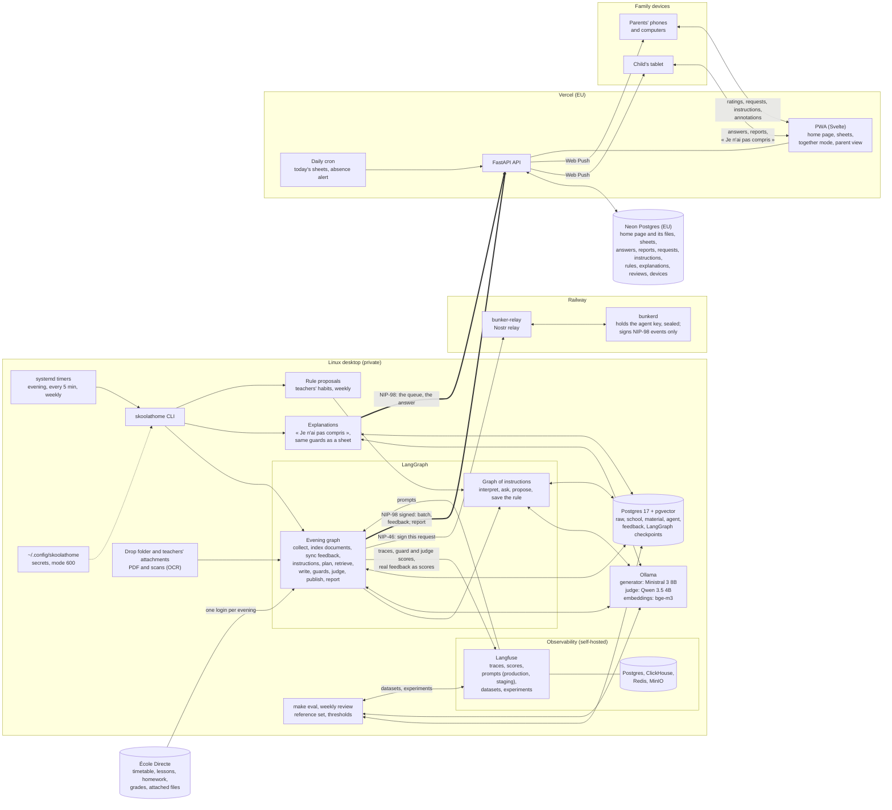

# skoolathome

Revision sheets for French *collège* students, built every evening from what the teachers wrote in École Directe, by a model that runs on a Linux desktop at home.

- **Grounded in the course.** Every question quotes the lesson or the textbook page it comes from. Deterministic guards check every quote, answer and computation. A judge model from another family then reads each sheet. When the agent cannot make a sheet that passes, it abstains and says why.
- **Private by design.** École Directe credentials, lesson texts and model calls stay on the Linux desktop. Only two things go online, with no surname: the finished sheets, and the home page (timetable, tests, grades, the first lines of recent lessons, and the files and links the teachers attached to them).
- **One home page.** It shows tomorrow's lessons (Monday's on a Friday) and the tests within three days. It shows the general average against the class's, then the latest grade and the average of each subject against the class. It suggests the sheets to do before the coming lessons and tests, from what the teachers wrote once each lesson was over, with the teachers' files and links to go further.
- **A sheet on request.** The parent asks for a sheet from the PWA; the Linux desktop makes it within minutes if it is on, and a notification says when it is ready. When the course is only in the notebook (a handout completed in class), the parent adds photos of it: the Linux desktop reads them, the parent checks the text, and the sheet is written from it first.
- **Done on a tablet**, alone (instant correction, hints) or together with a parent (✓ ~ ✗ ratings, parent guide). A question not understood gets its own explanation, from the lesson, within minutes while the computer is on. The parent can ask for a sheet, give instructions in plain French, accept the rules the agent proposes from the teachers' habits, and annotate a few sheets each week.
- **Measured.** Every sheet has a Langfuse trace, and real answers and reports come back to that trace. A reference set (`make eval`) blocks any prompt or model change that makes the sheets less correct, the search less precise, the instructions misread, or the judge disagree with the parent. Every change is written in a journal, watched for two weeks, and undone in one command (`evals/PROCEDURE.md`). The difficulty of each subject follows the child's success when working alone.

The family-facing app and the command messages are in French.

## Architecture



| Component | Where | Role |
|---|---|---|
| Collector | Linux desktop | Reads École Directe twice a day, at 7:15 and 18:30 on its own timer (one login each time, never retried in a loop), into `raw` (responses as received) and `school` (a common format). In the same session, it downloads once each file a teacher attached to a lesson. The PDFs are indexed for the sheets; every format (images, Word, slides, GeoGebra) is offered on the home page. It also keeps the web links the teacher put in the lesson. Then it puts the home page online. It never asks the model nor waits for it: a stuck Ollama cannot hold it back, and a failure here reaches the parent as « École Directe : collecte en échec », never as a sheet problem. |
| Evening graph | Linux desktop, LangGraph | Plans the evening's sheets from rules (no model involved), gathers the lesson texts and the closest document pages, has the generator write each sheet in an imposed JSON shape, runs the guards, then the judge. A question the guards or the judge refuse is left out, and the sheet goes on when enough remain; otherwise the next generation writes only the questions missing. A long sheet (from 20 minutes) is written in parts of about six questions, one lesson set each, so one part lost is not the whole sheet. Up to three generations per sheet, else an abstention with its reason. Checkpoints in Postgres: a run stopped half-way resumes. |
| Graph of instructions | Linux desktop, LangGraph | Turns « le prof d'histoire interroge à chaque cours » into a rule. It asks instead of guessing, and saves nothing until the parent approves. It pauses between steps (`interrupt`), resumed when the parent's reply comes back. |
| Home page | Linux desktop, then the PWA | After each collection, computed without a model: the coming lessons and tests; the averages of the current period, counted as École Directe does (each grade on 20, weighted by its coefficient, the « non significative » ones left out), and the general average as the subject averages added up and divided by their number; the latest grades with the class's figures; and a suggestion per lesson or test with the lesson's first lines, files and links. The files go online first, one signed call each and only once (4 MB at most per file; a larger one stays on École Directe), paced to the bunker's rate policy; then the page, with one signed call, separate from the batch. The API keeps only the files of the latest page and opens each one with a link signed for two days, which also works in Safari on the iPad. When the API cannot take the page, the next explanation pass sends it again. The PWA picks « tomorrow » from its own clock. |
| Rule proposals | Linux desktop | Once a week, looks in what was collected for a teacher's habit (an oral quiz on the lesson, seen in the lesson notes and the grades), and proposes the matching rule with the facts behind it. No model. A refused proposal never comes back. |
| Explanations and requested sheets | Linux desktop | Every 5 minutes while the computer is on (7:00 to 22:00), one signed call asks the API what waits: « Je n'ai pas compris » requests and sheets the parent asked for. Each explanation is made from the lesson its sheet came from, under the same guards as a sheet, or refused with its reason. A requested sheet is made at once by the same run as `evening --only-requests` (no École Directe call); the API notifies the parent when it arrives. Three tries per request, then the parent is told it waits for the evening. The photos of the notebook sent with a request are read first, by the generator's model on the processor only (`[vision]` in `models.toml`: on this laptop's Intel graphics, encoding an image crashes the driver), about 3 minutes per photo; the text goes back online, the API deletes the photos, and the parent checks the text before the sheet is written. A copy of each photo stays in `data/photos/`. Never at the same time as the evening run: one model user at a time. |
| Ollama | Linux desktop | All model calls go through its OpenAI-compatible API: changing the engine is a configuration file. `src/skoolathome/agent/engines/` holds llama.cpp (Vulkan iGPU, or processor only) and OpenVINO (iGPU, NPU), compared with the same model by `make eval` and `skoolathome engines compare`. |
| App database | Linux desktop, Docker | Postgres with pgvector, separate from Langfuse's, so Langfuse can be wiped without touching the student's data. |
| Langfuse | Linux desktop, Docker | One trace per sheet, with the subject, the rule, the format, the model and the prompt versions. It also holds the guard and judge scores, the real feedback, the managed prompts with their `production` and `staging` labels, the reference datasets and the `make eval` experiments. Stopped outside the evening run, it frees 3 to 4 GB of RAM. |
| Remote signer | Railway | [nostr-remote-signer](https://github.com/bonpiedlaroute/nostr-remote-signer): the Linux desktop never holds the key that the API trusts. Every call to the API is a NIP-98 event signed through NIP-46, and the signer only signs that event kind. |
| API and PWA | Vercel, Neon | FastAPI functions and the Svelte app. Devices pair with a one-time code and keep an HttpOnly session cookie. The Linux desktop authenticates with NIP-98. Web Push carries the evening report, the weekly review and the finished sheets. Each sheet downloads as a PDF made on demand (fpdf2, DejaVu fonts, formulas written as text), with room to answer and the correction on its own page, by a link signed for two days. The parent can remove a sheet from every list (« Retirer », undone by `POST /api/sheets/<id>/restore`); its answers are kept. Sheets whose date has passed are folded under « Fiches passées ». A request can bring up to 6 photos of the notebook, made 1024 pixels in JPEG on the phone; they stay online only until the Linux desktop has read them (7 days at most). |

Each evening, the collection sends the home page with its new files. Then the evening run makes four signed calls: it fetches the feedback, publishes one batch, sends the home page again with the new sheets, and sends the report. It works on the data already collected, waits for a collection in progress, and runs even when École Directe failed. The batch carries the sheets, the answers to the parent's requests and instructions, the agent's rule proposals, the list of rules and the weekly review. Between evenings, the explanation timer makes one signed call every 5 minutes, more when it has an explanation or a requested sheet to send.

## Installation

This is a single-family setup: one Linux desktop, one student, a few devices. Budget an afternoon.

### What you need

- **A Linux desktop that stays on in the evening**, with 16 GB of RAM at least (32 GB is comfortable: the generator takes about 6 GB, Langfuse 3 to 4 GB). Developed on Ubuntu 22.04 with an Intel Core Ultra 5 125U and no discrete GPU: a sheet takes 7 to 10 minutes.
- **Docker** with Compose, [uv](https://docs.astral.sh/uv/), Node.js 20 or later, git, openssl.
- **Accounts**: an École Directe parent account, GitHub, [Vercel](https://vercel.com) (Hobby plan, with its Neon integration), [Railway](https://railway.com).
- Optional, for scanned documents: `sudo apt install ocrmypdf tesseract-ocr-fra`.

### 1. Code and local database

```bash
git clone https://github.com/bonpiedlaroute/skoolathome.git && cd skoolathome
uv sync
(cd web && npm ci)

mkdir -p ~/.config/skoolathome && chmod 700 ~/.config/skoolathome
(umask 077 && openssl rand -hex 24 > ~/.config/skoolathome/app-db-password)
docker compose -f deploy/compose.yaml up -d      # Postgres 17 + pgvector on 127.0.0.1:5433
uv run skoolathome db migrate
make test                                         # Python and PWA tests (they create throw-away databases)
```

### 2. École Directe

```bash
uv run skoolathome-ed-probe --interactive   # asks for the login, answers the security question once
uv run skoolathome collect
uv run skoolathome summary                  # upcoming tests and lessons, without any model
```

The credentials are stored in `~/.config/skoolathome/ecoledirecte.json` (mode 600). The model never sees them.

### 3. Local models

```bash
curl -fsSL https://ollama.com/install.sh | sh
sudo mkdir -p /etc/systemd/system/ollama.service.d
sudo tee /etc/systemd/system/ollama.service.d/override.conf >/dev/null <<'EOF'
[Service]
Environment="OLLAMA_HOST=127.0.0.1:11434"
Environment="OLLAMA_CONTEXT_LENGTH=8192"
Environment="OLLAMA_NUM_PARALLEL=1"
Environment="OLLAMA_MAX_LOADED_MODELS=1"
Environment="OLLAMA_KEEP_ALIVE=5m"
EOF
sudo systemctl daemon-reload && sudo systemctl restart ollama
ollama pull ministral-3:8b-instruct-2512-q4_K_M
ollama pull qwen3.5:4b-q4_K_M
ollama pull bge-m3
uv run skoolathome llm bench      # reading and writing speed, memory, per model
```

On an Intel iGPU, the developer's Linux desktop also sets `OLLAMA_IGPU_ENABLE=1` (with the `ollama` user in the `render` and `video` groups) and `LLAMA_ARG_THREADS` to its number of performance threads. The models are declared in `src/skoolathome/agent/models.toml`.

### 4. Langfuse

```bash
deploy/langfuse/langfuse.sh init     # secrets in ~/.config/skoolathome/langfuse.env and langfuse.json
deploy/langfuse/langfuse.sh start    # http://localhost:3000, a few minutes the first time
uv run skoolathome prompt push       # the prompts of src/skoolathome/agent/prompts/, labelled production
uv run skoolathome llm try           # a first traced call: it prints the trace link
```

The login is `parent@skoolathome.local`, and the password is `LANGFUSE_PASSWORD` in `langfuse.env`. Everything works without Langfuse: tracing is then off, and the local copies of the prompts are used.

### 5. Remote signer on Railway

```bash
docker build -t skoolathome-bunker deploy/railway
printf 'passphrase: '; read -rs BUNKER_PASSPHRASE; echo; export BUNKER_PASSPHRASE
mkdir -p ~/.config/skoolathome/bunker-keys && cd ~/.config/skoolathome/bunker-keys
for k in signer identity; do
  openssl rand -hex 32 | docker run --rm -i -e BUNKER_PASSPHRASE skoolathome-bunker \
    sh -c "seal /tmp/k.json >&2; cat /tmp/k.json" > $k.sealed.json
done
chmod 600 *.sealed.json && cd -
```

The first public key printed is the transport key; the second is the agent's identity. Then create two Railway services from your GitHub repository, both with root directory `deploy/railway`:

| Service | Variables | Network |
|---|---|---|
| `bunker-relay` | `BUNKER_ROLE=relay`, `BUNKER_RELAY_SIGNERS=<transport public key>`, `PORT=7777` | public domain, target port 7777 |
| `bunkerd` | `BUNKER_ROLE=vault`, `BUNKER_PASSPHRASE`, `BUNKER_RELAY=wss://<relay domain>`, `BUNKER_SIGNER_SEALED_B64=$(base64 -w0 signer.sealed.json)`, `BUNKER_IDENTITY_SEALED_B64=$(base64 -w0 identity.sealed.json)` | no public domain, a volume on `/data` |

Read the `bunker URI` and `identity` lines in the logs of `bunkerd`, then:

```bash
uv run skoolathome signer new-token --uri 'bunker://…' --identity npub1…
# add the BUNKER_AGENTS_JSON it prints to the variables of bunkerd
uv run skoolathome signer test              # « Signé à distance (type 27235) »
uv run skoolathome signer test --kind 1     # « Refusé » : the signer only signs NIP-98 events
```

The passphrase is the root of trust: anyone with access to the Railway project can unseal the keys.

### 6. API and PWA on Vercel

1. Push the repository to GitHub, and import it in Vercel. `vercel.json` builds the PWA, serves the API from `main.py` in region `cdg1`, and schedules the daily cron.
2. In the project's Storage tab, add a **Neon** database in an EU region. It sets `DATABASE_URL`.
3. In Settings, Environment Variables (Production):

| Variable | Value |
|---|---|
| `SKOOLATHOME_AGENT_PUBKEY` | the agent's identity, `npub1…` (step 5) |
| `SKOOLATHOME_VAPID_PUBLIC_KEY`, `SKOOLATHOME_VAPID_PRIVATE_KEY` | from `uv run skoolathome api vapid-keys` |
| `CRON_SECRET` | `openssl rand -hex 32` |
| `SKOOLATHOME_BOOTSTRAP_CODE` | optional: pairs the first parent device without the Linux desktop (`uv run skoolathome api bootstrap-code`) |
| `SKOOLATHOME_ABSENCE_HOURS` | optional, default 36: alert when nothing was published for that long on a school day |

4. Deploy, then migrate Neon from the Linux desktop and save the API address:

```bash
DATABASE_URL='postgresql://…neon.tech/…?sslmode=require' uv run skoolathome api migrate
uv run skoolathome api set-url https://<your-project>.vercel.app
```

Redeploy after each change of variables: Vercel reads them at deployment.

Run `api migrate` again after every push that adds a file to `src/skoolathome/api/migrations/`. Until you do, the API answers 503 "online database not migrated", the laptop's log says which command to run, and the PWA says the server is waiting for an update.

### 7. Pair the devices

```bash
uv run skoolathome pair --label "Parent phone"    # a QR code, a link and an 8-character code
```

Open the link on the phone (or scan the QR code, or type the code at the site's address). Then, from the parent view on that phone, **Appareils** creates the codes for the child's tablet (role *Enfant*) and the other devices. On the tablet, add the site to the home screen, and allow notifications.

### 8. The first evenings

```bash
uv run skoolathome plan                       # what tonight would make, and what it skips, with the reason
uv run skoolathome evening --no-publish       # the whole run, kept on the Linux desktop
uv run skoolathome sheets list && uv run skoolathome sheets show <id>
uv run skoolathome collect --publish          # École Directe, then the home page online
uv run skoolathome evening                    # the real one: sheets, publish, report
```

Then the timers: the École Directe collection at 7:15 and 18:30, the evening run at 20:30, the explanations every 5 minutes from 7:00 to 22:00, and the rule proposals on Saturday morning. Without the collection timer, nothing reads École Directe: the home page then keeps the data of the last collection run by hand. **Edit `WorkingDirectory` in the four `deploy/systemd/*.service` files** to your clone's path, and:

```bash
cp deploy/systemd/skoolathome-*.service deploy/systemd/skoolathome-*.timer ~/.config/systemd/user/
systemctl --user daemon-reload
systemctl --user enable --now skoolathome-collect.timer skoolathome-evening.timer skoolathome-explain.timer skoolathome-proposals.timer
loginctl enable-linger "$USER"                # so the user timers run without an open session
```

## Day to day

| Command | What it does |
|---|---|
| `skoolathome evening [--collect] [--no-publish] [--restart]` | the evening run, on the data already collected; `--collect` collects first, before Ollama is asked; resumes an interrupted run of the same day |
| `skoolathome ask maths les fractions égales --revision [--minutes 45] --now` | a sheet on demand, made and published now (also from the PWA, where the parent picks a duration from 10 minutes to an hour) |
| `skoolathome instructions add "…"` / `instructions sync` | an instruction in plain French; read the ones written in the PWA now |
| `skoolathome rules list` / `rules set before_test target_minutes=30` | the rules, versioned; change one by hand. By default, before a test: one complete preparation of about 45 minutes (18 questions: course questions, exercises, written answers), shown three days before or at once when the test is known later, its minutes counted over the evenings until the test |
| `skoolathome material index` | index the PDFs dropped in `data/manual/<subject>/`, and the teachers' attachments |
| `skoolathome collect [--no-download] [--publish]` | one collection now, apart from the model; `--publish` (the timer) then puts the home page online and tells the parent if École Directe failed; `--no-download` lists the attached files without downloading them |
| `skoolathome ed attachments` | the files attached to the lessons, and whether each one was downloaded |
| `skoolathome explain --now` | answer the « Je n'ai pas compris » requests and make the requested sheets now |
| `skoolathome proposals run [--dry-run]` | look for the teachers' habits, and propose the matching rules |
| `skoolathome scores send --fetch` | real feedback to Langfuse now, without waiting for the evening |
| `skoolathome review [--send]` | the weekly review; sent automatically from Friday |
| `skoolathome home [--send]` | the home page as the PWA shows it; `--send` puts it online now (no École Directe call) |
| `make eval` / `make eval-production` | candidate prompts (`staging`) against `production` on every set: sheets, tests, search (recall@3), instructions, judge, evening plan |
| `skoolathome prompt promote <name> <version>` / `prompt rollback <name>` | to production only after a passing `make eval`; back to the previous version in one command (`make promote`, `make rollback`) |
| `skoolathome changes` | the journal of changes: why, the `make eval` behind each one, before and after, how to undo it |
| `skoolathome eval add-retrieval <lesson> --document … --page N` / `eval add-corrections` / `eval hold <id>` | a lesson and its expected page; every [Modifier]; a case kept for validation only |
| `skoolathome difficulty` | the target difficulty of each subject, from the answers given alone |
| `skoolathome engines compare` | quality and speed of each engine measured, side by side |

## Development

```bash
make test                          # pytest, vitest, svelte-check
uv run skoolathome api serve       # the API and the built PWA on http://127.0.0.1:8000, against a local database
make eval-quick                    # test detection and the traps that need no model
```

```
src/skoolathome/
  collectors/   École Directe and the drop folder
  agent/        evening graph, graph of instructions, proposals, explanations, guards, judge, prompts, engines
  rules/        rules, evening plan, test detection
  evaluation/   reference set, make eval, weekly review
  material/     PDF extraction, OCR, pgvector search
  api/          FastAPI app and Neon migrations
  publish/      NIP-46 session and NIP-98 client
  schema/       shapes shared by the Linux desktop and the API
  store/        local database access and migrations
web/            the PWA (Svelte 5)
deploy/         Docker Compose, Langfuse, Railway image, systemd units, engine launchers
evals/          traps, test sentences, retrieval cases, the change procedure (PROCEDURE.md)
```
